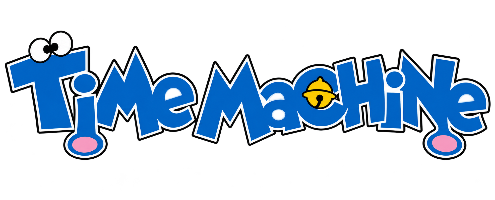

 

  # Time Machine

  **One place for every Doraemon episode and movie. Ever.**

   

---

## Why?

Doraemon is one of the biggest franchises on Earth — **1,300+ manga chapters, 2,700+ episodes across three anime series, and 60 movies**. And yet there is no single place to actually watch it. Episodes are scattered across sketchy websites, the old DVD sets are out of print, and the original **1973 anime is already half lost media** — of its 52 segments, only around 20 survive today.

Time Machine exists so that never happens again. A fan-built archive, born from 11+ years of love for this show, meant to keep every era of Doraemon discoverable, watchable, and remembered.

## What it's gonna be

> **This repo is under construction** — everything below is the blueprint, not the current state.

- **A complete catalog** — every movie and every episode of the 1973, 1979 and 2005 anime, browsable in one place
- **A built-in player** — Time Machine hosts no files; it indexes direct links from around the web and plays them through its own player
- **Handlers** — a folder of small JS decoders so every stream type (m3u8, direct video, embeds...) just works
- **Deep metadata** — characters, gadgets used, aired dates, summaries and more, for every single entry
- **Every language** — Japanese originals, Hindi, Tamil, Telugu, English dubs... every link gets tagged and filterable
- **A lost-media registry** — the 1973 series gets special treatment: tracking exactly what survives, what's audio-only, and what's still missing
- **Community-powered** — the archive starts empty, and slowly fills up. Found an episode on YouTube? You'll be able to submit it. That's how the shelves get stocked

## Roadmap

- [ ] Project setup & data schema
- [ ] Catalog browsing — movies + all three series
- [ ] Video player + handler system
- [ ] Community submissions (GitHub + Discord bot)
- [ ] Search & filters — by language, gadget, character
- [ ] 1973 lost-media registry
- [ ] ...and 2,700+ episodes of data entry

## Contributing

The doors aren't open yet — but when they are, this archive only works with your help. Whether it's a link, a summary, or a gadget list, every submission fills in a piece of Doraemon history. *Watch this space.*

## Disclaimer

Time Machine is a non-profit fan archive. It **does not host, upload, or store any video files** — it only indexes links to media hosted elsewhere, with priority given to official sources. Doraemon is the property of Fujiko-Pro, Shogakukan and TV Asahi. Takedown requests will be honored promptly.
